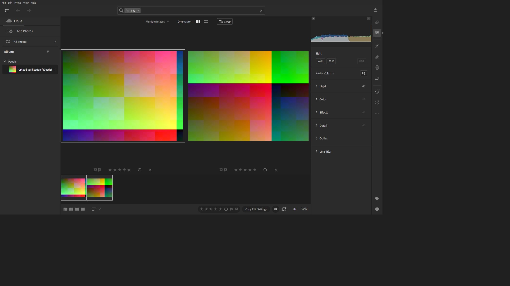

# Jose Calderon

Computer science student at Northeastern Illinois University in Chicago, with interests in cybersecurity, software development, and game design. I build applications and refine them through testing.

## Projects

### Photo editing application

An in-progress desktop photo editor with library organization, adjustment controls, selection and masking tools, and export workflows. The interface and features remain in development.

### Music and podcast player

An in-progress mobile-focused player with playlists, library management, podcast browsing, playback controls, and offline downloads. The project has a web frontend and a separate backend; playback and offline reopening have been tested on an iPhone, with further device testing still needed.

### 3D game environments

Designed and refined 3D environments, including terrain, asset placement, access routes, and player navigation. Used in-engine visual reviews and gameplay tests to improve placement and accessibility. I have also explored Unreal Engine for game development.

### Other projects

- [Media library application](https://github.com/iconicJose/MediaServer-Published) — A Windows application for organizing and playing a personal media library.
- [Lighting control](https://github.com/iconicJose/light-control) — A Windows tray application for adjusting supported displays' brightness.

[LinkedIn](https://www.linkedin.com/in/jose-calderon-504b65304/)
